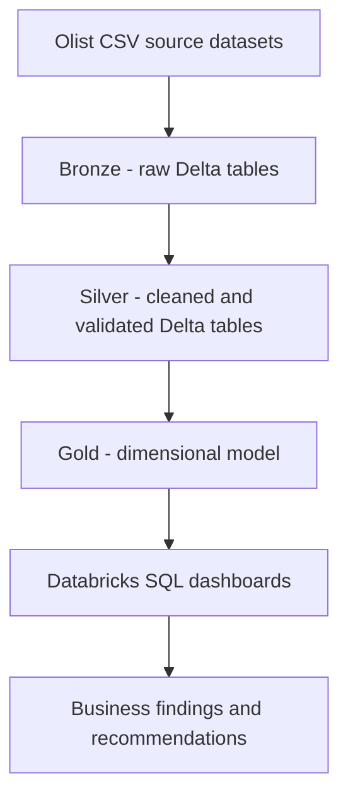

# Olist E-Commerce Data Warehouse

An end-to-end e-commerce data warehouse built with **Databricks, PySpark, Delta Lake and SQL**, using the Olist Brazilian E-Commerce dataset.

> **Project status:** The Bronze, Silver and Gold warehouse layers and five business-analysis dashboards have been developed. Add measured Phase 6 optimization results only after completing and validating those experiments.

## Project overview

This project transforms raw Olist CSV datasets into analytics-ready Delta tables using a Medallion Architecture.

- **Bronze:** ingest raw source files into Delta tables with ingestion metadata.
- **Silver:** clean, standardize, deduplicate and validate records; isolate data-quality exceptions.
- **Gold:** build fact and dimension tables for analytical queries.
- **Analytics:** investigate revenue growth, customer retention, delivery operations, customer experience and seller/product performance.

## Architecture



See [`docs/architecture.md`](docs/architecture.md) for the detailed architecture.

## Technology stack

- Databricks
- Apache Spark / PySpark
- Delta Lake
- Databricks SQL
- Unity Catalog
- Medallion Architecture
- Git and GitHub

## Repository structure

```text
.
├── notebooks/                 # Exported Databricks notebook source files
├── sql/
│   ├── validation/            # Data and model validation queries
│   └── business_analysis/     # Business analysis SQL
├── docs/
│   ├── architecture.md
│   ├── data_model.md
│   ├── project_setup.md
│   └── business_findings.md
├── dashboards/
│   ├── README.md
│   └── screenshots/
└── README.md
```

## Source data

The project uses the Olist Brazilian E-Commerce Public Dataset. Obtain the dataset from its official Kaggle dataset page:

https://www.kaggle.com/datasets/olistbr/brazilian-ecommerce

Do not commit the raw CSV files to this repository. Download them separately and upload them to the Databricks Volume described in [`docs/project_setup.md`](docs/project_setup.md).

## Databricks setup

The notebooks currently use the Unity Catalog catalog and schemas below:

- Catalog: `e-commerce`
- Schemas: `ecommerce_bronze`, `ecommerce_silver`, `ecommerce_gold`
- Bronze Volume: `raw_files`

Expected source location:

```text
/Volumes/e-commerce/ecommerce_bronze/raw_files/archive/
```

Read [`docs/project_setup.md`](docs/project_setup.md) before running the notebooks. Update catalog, schema and volume names if your workspace uses different names.

## Data model

The Gold layer contains the following planned/implemented model tables:

**Dimensions**
- `dim_customers`
- `dim_products`
- `dim_sellers`
- `dim_geography`
- `dim_date`

**Facts**
- `fact_orders` — one row per order
- `fact_order_items` — one row per order line
- `fact_payments` — one row per payment
- `fact_reviews` — one row per review record (confirm the exact key/grain in the notebook)

See [`docs/data_model.md`](docs/data_model.md). Confirm all columns and relationships against the exported notebooks before publishing a final schema diagram.

## Business investigations

The project includes five dashboard investigations:

1. Revenue and Sales Growth
2. Customer Retention
3. Delivery and Operations
4. Customer Experience
5. Seller and Product Performance

Dashboard screenshots belong in `dashboards/screenshots/`. The business findings document is a structured template; replace placeholders with findings supported by your actual dashboard results.

## Running the project

This is a Databricks project, not a standalone local PySpark application. The notebooks require access to a Databricks workspace, Unity Catalog objects and the source dataset. Follow [`docs/project_setup.md`](docs/project_setup.md) for the execution order.

## Data quality and engineering considerations

- Preserve the grain of each fact table.
- Avoid joining facts with different grains before aggregating them to a common grain.
- Validate dimension natural-key uniqueness and fact-to-dimension key coverage.
- Treat unmatched or invalid records explicitly rather than silently dropping them.
- Avoid committing credentials, access tokens, workspace configuration or raw source data.
- Do not claim performance improvements without recording measured before-and-after results.

## Screenshots and demonstration

Add dashboard screenshots to `dashboards/screenshots/` and update [`dashboards/README.md`](dashboards/README.md). A short walkthrough should show the architecture, notebook pipeline, Gold model, dashboards and evidence-based findings.

## License

Add a license only after deciding which license you want to apply to your own project code. The source dataset remains subject to its own terms.
