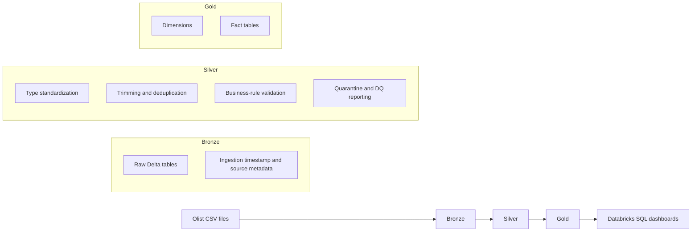

# Data Architecture

## Medallion flow

## Layer responsibilities

### Bronze
- Reads the nine Olist CSV source datasets.
- Preserves source fields as strings during initial ingestion.
- Adds ingestion metadata such as `_ingested_at` and `_source_file`.
- Stores the ingested data as Delta tables.

### Silver
- Standardizes values and data types.
- Trims string fields and handles invalid/null keys.
- Deduplicates using defined business keys.
- Applies business-rule and referential checks.
- Stores rejected records in data-quality quarantine tables where applicable.

### Gold
- Creates conformed dimensions and fact tables for analytics.
- Uses surrogate keys to connect fact records to dimensions.
- Maintains explicit fact-table grain.

## Source datasets

The pipeline uses these nine source files:

1. `olist_customers_dataset.csv`
2. `olist_geolocation_dataset.csv`
3. `olist_order_items_dataset.csv`
4. `olist_order_payments_dataset.csv`
5. `olist_order_reviews_dataset.csv`
6. `olist_orders_dataset.csv`
7. `olist_products_dataset.csv`
8. `olist_sellers_dataset.csv`
9. `product_category_name_translation.csv`

## Execution order

1. `01_bronze_ingestion`
2. `02_silver_transformation`
3. `03_gold_dimension_tables`
4. `04_gold_fact_tables`
5. `05_delta_lake_optimization` (when completed)

Update this document if notebook names or implementation details change.
