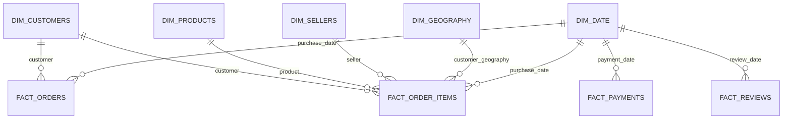

# Gold Data Model

## Overview

The Gold layer is designed as a dimensional model with shared dimensions and business-process fact tables.

> This is a conceptual relationship diagram, not a verified physical schema export. Check the actual notebook joins and key columns before treating every relationship above as implemented. In particular, confirm which date roles and geography keys exist in each fact table.

## Dimensions

| Dimension | Purpose |
|---|---|
| `dim_customers` | Customer descriptive attributes |
| `dim_products` | Product attributes and translated category |
| `dim_sellers` | Seller descriptive attributes |
| `dim_geography` | Geographic attributes such as ZIP prefix, city and state |
| `dim_date` | Calendar attributes for date-based analysis |

## Facts and grain

| Fact table | Intended grain | Typical analysis |
|---|---|---|
| `fact_orders` | One row per order | Order counts, status and order-level measures |
| `fact_order_items` | One row per order line | Item revenue, freight and product/seller analysis |
| `fact_payments` | One row per payment record | Payment type and payment value |
| `fact_reviews` | One row per review record | Review scores and review trends |

## Modelling cautions

- Do not join facts of different grains directly unless they are first aggregated to a common grain.
- Validate uniqueness of dimension surrogate keys and natural keys.
- Validate that fact foreign keys resolve to dimension records.
- Confirm whether `fact_order_items` geography represents the customer or seller before interpreting state-level metrics.
- Confirm review uniqueness and the exact review fact key from the implemented SQL.
- Record any unknown-member/surrogate-key strategy used by the notebooks.
